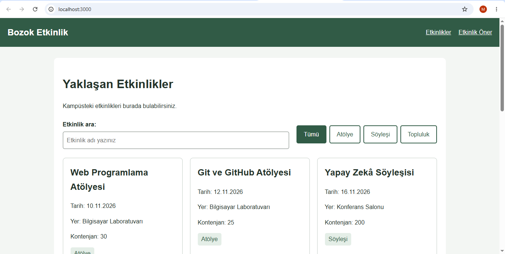

# Kampüs Etkinlik Panosu

Bu projede kampüsteki etkinlikler listelenmektedir. Kullanıcı etkinlik arayabilir, etkinlikleri türüne göre filtreleyebilir ve formdan etkinlik önerisinde bulunabilir.

## Kullanılan teknolojiler

- HTML
- CSS
- JavaScript
- Node.js

## Projeyi indirme

Terminalde aşağıdaki komutları çalıştırın:

```bash
git clone https://github.com/Merve-ibrahim/bmh231-odev2.git
cd bmh231-odev2
```

## Projeyi çalıştırma

Proje klasöründe terminali açıp şu komutu yazın:

```bash
npm start
```

Daha sonra tarayıcıda `http://localhost:3000` adresini açın.

PowerShell'de hata alınırsa `npm.cmd start` kullanılabilir.

## API testleri

| Yöntem ve yol | Sonuç |
|---|---|
| GET /api/etkinlikler | 200 – Tüm etkinlikleri getirir. |
| GET /api/etkinlikler?tur=atolye | 200 – Atölyeleri getirir. |
| GET /api/etkinlikler/2 | 200 – 2 numaralı etkinliği getirir. |
| GET /api/etkinlikler/999 | 404 – Etkinlik bulunamadı. |
| DELETE /api/etkinlikler/2 | 405 – Yöntem desteklenmiyor. |

Test sonuçları `API_Testleri.txt` dosyasında bulunmaktadır.

## Erişilebilirlik

Lighthouse testinde erişilebilirlik sonucu 100 oldu. E-posta etiketi geçici olarak kaldırıldığında sonuç 93 oldu. Testten sonra etiket tekrar eklendi.
## Ekran görüntüsü

